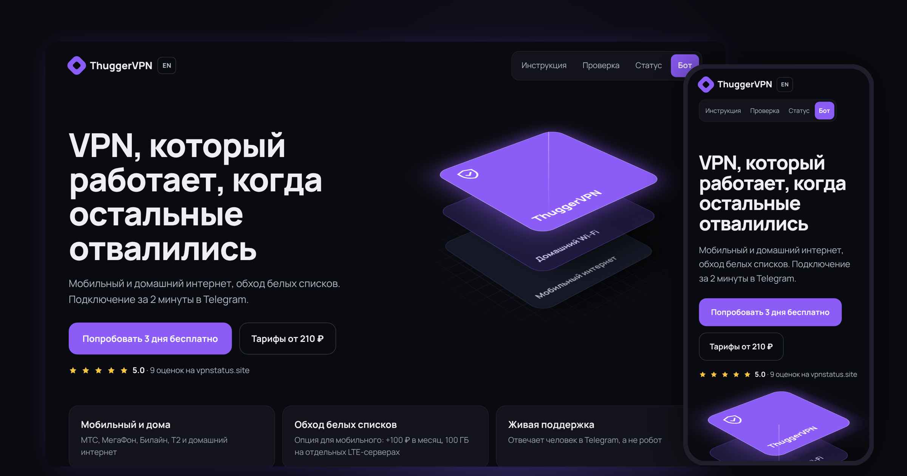
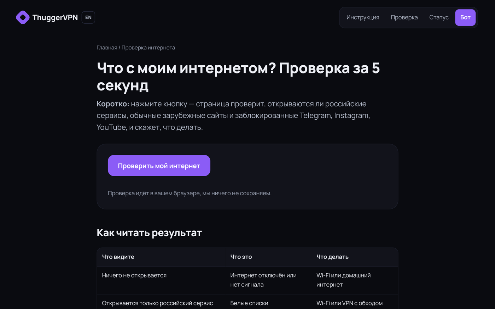
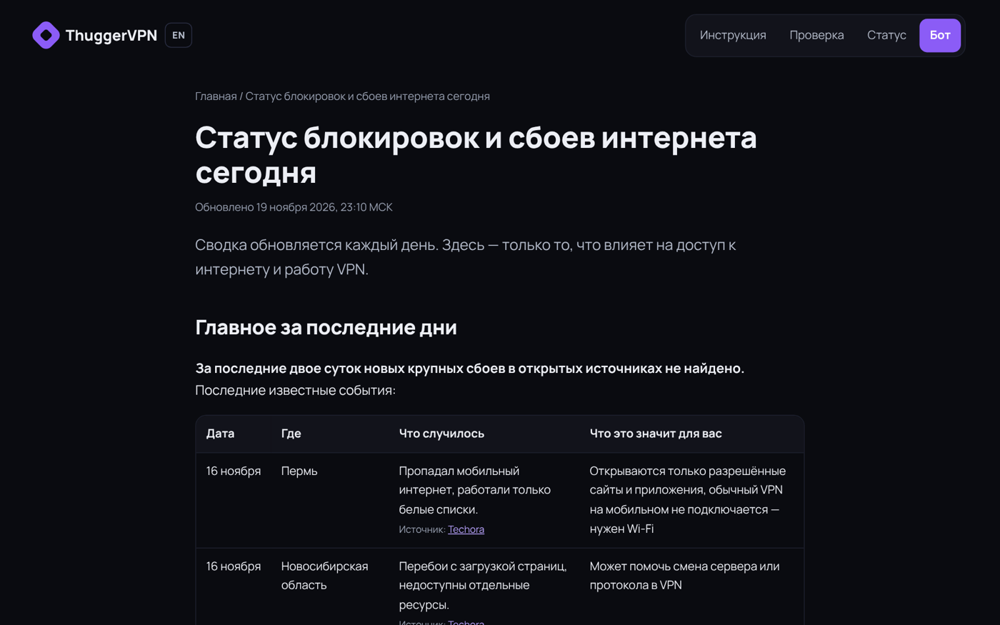
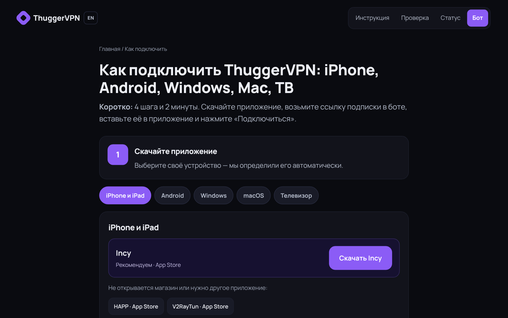
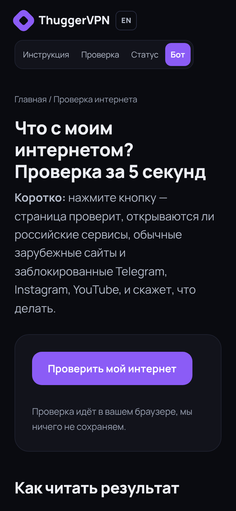
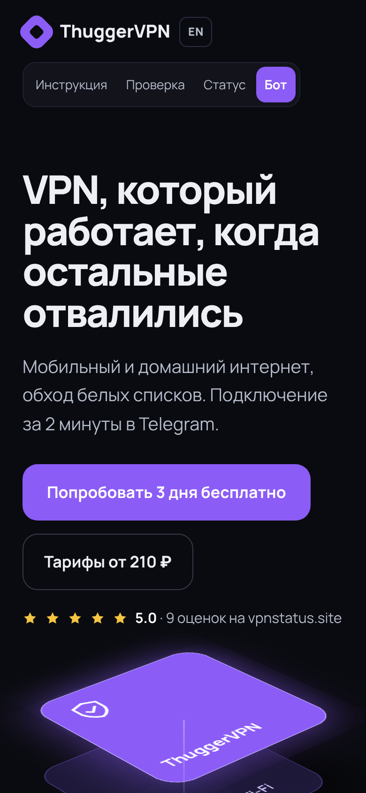
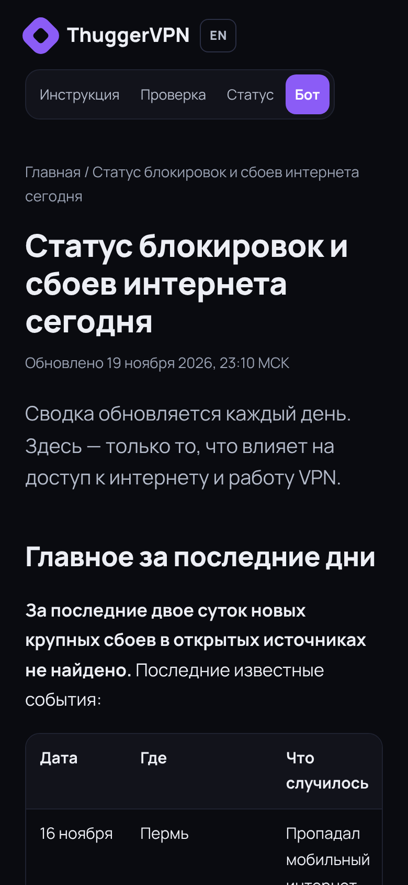

# ThuggerVPN

**Статус блокировок в России, проверка интернета за 5 секунд и инструкции по VPN** 
Russia internet blocking status, a 5-second connection check and VPN setup guides · <a href="#-english">English ↓</a>

     

<a href="https://thuggervpn.github.io/check/"><b>Проверить интернет</b></a> · <a href="https://thuggervpn.github.io/status/"><b>Статус сегодня</b></a> · <a href="https://thuggervpn.github.io/podklyuchenie/"><b>Как подключить</b></a> · <a href="https://t.me/ThuggerVPN_bot"><b>Попробовать бесплатно</b></a>

---

## 📡 Сводка блокировок

Обновляется каждый день. Последнее обновление: **22 ноября 2026, 08:56 МСК**. Полная картина - на странице [статуса](https://thuggervpn.github.io/status/) и в [индексе блокировок](https://thuggervpn.github.io/index-blokirovok/).

| Дата | Где | Что случилось | Источник |
|---|---|---|---|
| 22 ноября | Архангельская | 🟧 Жалобы на мобильный интернет у МегаФона, Билайна и Т2 в шести регионах | [Метарейтинг](https://cybersport.metaratings.ru/articles/chto-s-mobilnym-internetom-v-rossii/) |
| 21 ноября | Вся Россия | ⚠️ Перебои YouTube вечером: не открывался сайт, сбоило приложение и воспроизведение | [Метарейтинг](https://cybersport.metaratings.ru/articles/chto-proishodit-s-youtube-segodnya/) |
| 21 ноября | Пермский край, Санкт-Петербург | 🟧 МТС: около 300 жалоб за сутки на пропавший мобильный интернет, SMS и звонки | [Hi-Tech Mail](https://hi-tech.mail.ru/news/145491-chto-segodnya-s-mts/) |
| 21 ноября | Кировская | 🟧 Билайн: почти 500 жалоб за сутки на мобильный интернет, звонки и SMS | [Hi-Tech Mail](https://hi-tech.mail.ru/news/145605-chto-segodnya-s-bilajn/) |
| 21 ноября | Санкт-Петербург | ⛔ Мобильный интернет отключали из-за угрозы беспилотников, жалобы шли также из Москвы и десятков регионов | [News.ru](https://news.ru/society/pochemu-ne-rabotaet-mobilnyj-internet-21-noyabrya-prichiny-sboi-v-rossii) |
| 21 ноября | Санкт-Петербург | 🟥 Утром в Петербурге открывались только сайты и приложения из белого списка | [Форпост Северо-Запад](https://forpost-sz.ru/a/2026-11-21/peterburzhcy-pozhalovalis-na-sboj-mobilnogo-interneta-utrom-21-noyabrya) |

🟥 белые списки · ⛔ отключение · 🟧 замедление · 🔒 блокировка VPN · ⚠️ сбой сервиса · 📜 решения властей

## 🧰 Инструменты

<table>
<tr>
<td width="50%" valign="top">

<h3><a href="https://thuggervpn.github.io/check/">Проверка интернета за 5 секунд</a></h3>
Белые списки, отключение или проблема с VPN - страница проверяет прямо в браузере и говорит, что делать. Ничего не сохраняет.
</td>
<td width="50%" valign="top">

<h3><a href="https://thuggervpn.github.io/status/">Статус блокировок сегодня</a></h3>
Ежедневная сводка сбоев мобильного интернета по регионам и операторам: <a href="https://thuggervpn.github.io/operator/mts/">МТС</a>, <a href="https://thuggervpn.github.io/operator/beeline/">Билайн</a>, <a href="https://thuggervpn.github.io/operator/megafon/">МегаФон</a>, <a href="https://thuggervpn.github.io/operator/t2/">Т2</a>. Каждое событие - со ссылкой на источник.
</td>
</tr>
<tr>
<td width="50%" valign="top">

<h3><a href="https://thuggervpn.github.io/podklyuchenie/">Как подключить VPN</a></h3>
iPhone, Android, Windows, macOS и телевизор - по шагам. Отдельно: что делать, если у вас российский Apple ID.
</td>
<td width="50%" valign="top">

<h3>Удобно с телефона</h3>
Сайт сделан в первую очередь для мобильного: проверка и инструкции открываются за секунды даже на медленном интернете.
</td>
</tr>
</table>

## 📊 Открытые данные

База событий открыта и обновляется ежедневно - для журналистов, исследователей и разработчиков. Используйте со ссылкой на источник.

- JSON: [`/data/blocking-events.json`](https://thuggervpn.github.io/data/blocking-events.json)
- [Индекс блокировок](https://thuggervpn.github.io/index-blokirovok/) - события за 7 и 30 дней по типам
- [Информер для вашего сайта](https://thuggervpn.github.io/informer/) - сводка блокировок одной строкой кода
- RSS: [русский](https://thuggervpn.github.io/feed.xml) · [English](https://thuggervpn.github.io/en/feed.xml)

## 📝 Свежие статьи

- [Не грузит YouTube с VPN: почему крутится загрузка и что делать](https://thuggervpn.github.io/blog/youtube-ne-rabotaet-s-vpn/)
- [Telegram не подключается: почему висит «Соединение» и что делать](https://thuggervpn.github.io/blog/telegram-ne-podklyuchaetsya/)
- [VPN и банковские приложения: почему Сбер и маркетплейсы не открываются](https://thuggervpn.github.io/blog/vpn-i-bankovskie-prilozheniya/)
- [VPN подключён, но интернета нет: 5 причин и что делать](https://thuggervpn.github.io/blog/vpn-podklyuchen-no-net-interneta/)
- [Не работает VPN на мобильном интернете: что делать в 2026 году](https://thuggervpn.github.io/blog/ne-rabotaet-vpn-na-mobilnom/)
- [Как выбрать VPN в 2026 году: 7 критериев, которые реально важны](https://thuggervpn.github.io/blog/kak-vybrat-vpn-2026/)

[Все статьи →](https://thuggervpn.github.io/blog/)

## ⭐ Отзывы клиентов

Независимый каталог [vpnstatus.site](https://vpnstatus.site/vpn/thuggervpn): **5.0 из 5**, 19 оценок, 100% отметили «работает». Данные на 21 ноября 2026.

| Оператор | Работает | Обход белых списков |
|---|---|---|
| МТС | 2/2 ✅ | 1/1 ✅ |
| МегаФон | 3/3 ✅ | 1/1 ✅ |
| Билайн | 3/3 ✅ | 3/3 ✅ |
| Т2 | 2/2 ✅ | 1/1 ✅ |
| Домашний интернет | 9/9 ✅ | - |

Пользовались ThuggerVPN? [Отметьте своего оператора](https://vpnstatus.site/vpn/thuggervpn) - это помогает другим выбрать.

## 🚀 О сервисе ThuggerVPN

VPN для мобильного и домашнего интернета с опцией обхода белых списков. Подключение за 2 минуты в Telegram, живая поддержка.

| | |
|---|---|
| 🎁 Пробный период | 3 дня бесплатно |
| 📱 Устройства | 2 устройства в тарифе, до 6 по +60 ₽ за каждое |
| 🛡️ Обход белых списков | +100 ₽ в месяц, 100 ГБ на отдельных LTE-серверах |
| 💬 Поддержка | [@ThuggerVPN_supp](https://t.me/ThuggerVPN_supp) |

| Тариф | Стоимость | В месяц |
|---|---|---|
| 1 мес. | 299 ₽ | 299 ₽/мес |
| 3 мес. | 855 ₽ | 285 ₽/мес |
| 6 мес. | 1530 ₽ | 255 ₽/мес |
| 12 мес. | 2520 ₽ | 210 ₽/мес · выгоднее всего |

---

## 🌍 English

**Daily status of mobile internet shutdowns, whitelist mode and VPN blocking in Russia** - with sources, a 5-second internet check and setup guides. Useful if you live in Russia, travel there or have family there.

- [Blocking status today](https://thuggervpn.github.io/en/status/) · [Internet check](https://thuggervpn.github.io/en/check/) · [Setup guide](https://thuggervpn.github.io/en/podklyuchenie/) · [Blocking index](https://thuggervpn.github.io/en/index-blokirovok/)
- Open data: [`blocking-events.json`](https://thuggervpn.github.io/data/blocking-events.json) · RSS: [`/en/feed.xml`](https://thuggervpn.github.io/en/feed.xml)

**Latest guides**

- [YouTube not working in Russia even with a VPN: causes and fixes](https://thuggervpn.github.io/en/blog/youtube-ne-rabotaet-s-vpn/)
- [Telegram not connecting in Russia: why it's stuck on "Connecting" and fixes](https://thuggervpn.github.io/en/blog/telegram-ne-podklyuchaetsya/)
- [Does WhatsApp work in Russia in 2026? What tourists and expats should know](https://thuggervpn.github.io/en/blog/does-whatsapp-work-in-russia/)
- [Russian bank apps not working with VPN: Sber, T-Bank, Ozon fixes](https://thuggervpn.github.io/en/blog/vpn-i-bankovskie-prilozheniya/)
- [VPN connected but no internet: 5 causes and fixes](https://thuggervpn.github.io/en/blog/vpn-podklyuchen-no-net-interneta/)
- [Travelling to Russia in 2026: internet, SIM cards and VPN - what to set up before you fly](https://thuggervpn.github.io/en/blog/travel-russia-internet-vpn/)

ThuggerVPN: 3 days free, then from 210 ₽/month - [Telegram bot](https://t.me/ThuggerVPN_bot) · reviews on [vpnstatus.site](https://vpnstatus.site/vpn/thuggervpn).

---

Сайт собирается автоматически: статьи - `_src/articles/` и `_src/articles_en/`, база событий - `_src/data/status.json`, сборка - `python3 _src/build.py`. Эта страница обновляется вместе с сайтом.
