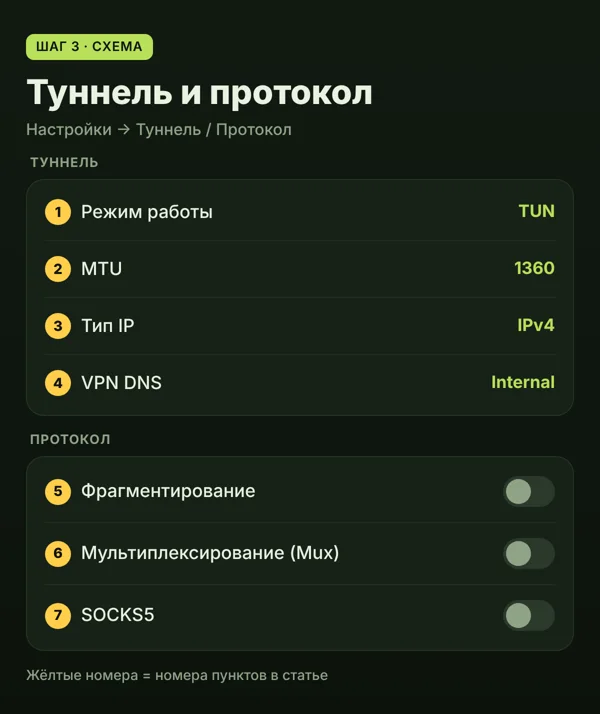
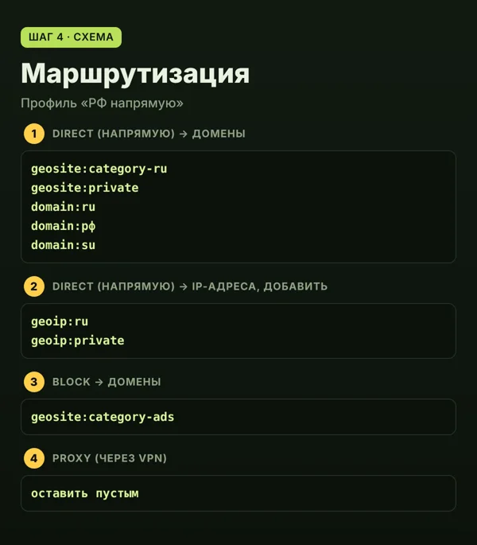
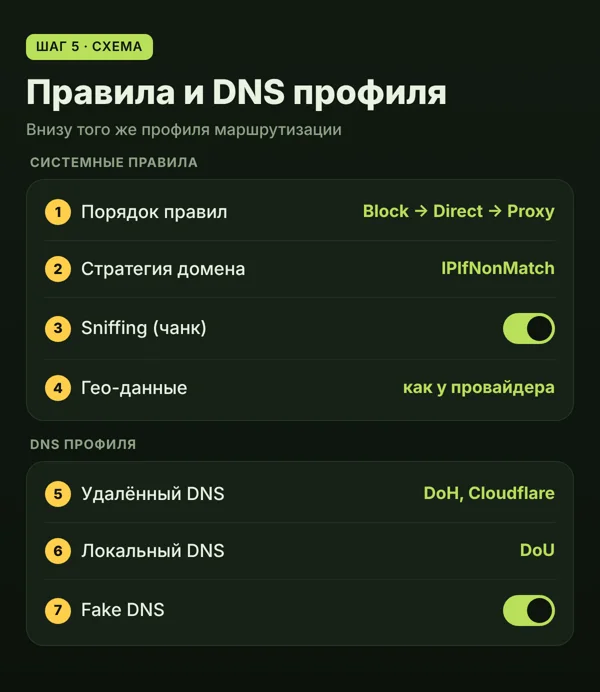
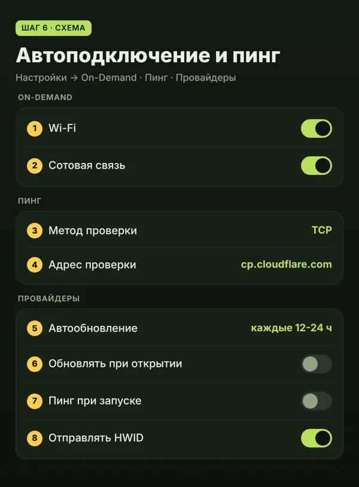
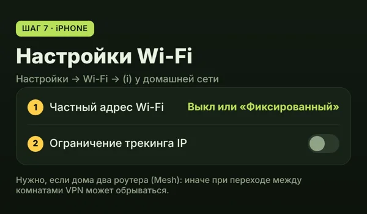

<b>Коротко:</b> если в Incy сайты иногда «зависают», банки не открываются с VPN, а на мобильном интернете скачет пинг, это почти всегда лечится настройками. Выберите сервер VLESS + Reality, поставьте MTU 1360, выключите фрагментирование и Mux, а российские сайты пустите напрямую. Ниже 7 шагов с картинками, каждое значение можно просто повторить.

Эти настройки мы подобрали и проверили на клиенте: сутки тестов на домашней оптике, 4G-модеме и мобильном интернете. Пример для iPhone и Mac, на Android пункты называются похоже.

<b>Что значат картинки.</b> На первом шаге настоящие скриншоты Incy. Дальше схемы: на них собраны нужные пункты и значения, а жёлтые номера совпадают с пунктами в тексте. В вашей версии приложения расположение может немного отличаться, ищите пункт по названию.

## Шаг 1. Подключите подписку

Если Incy ещё пустой, сначала добавьте подписку: скопируйте ссылку у VPN-сервиса, откройте Incy и нажмите «Из буфера». Подробно с самого начала в статье [«Incy VPN: как добавить подписку»](/blog/incy-vpn-kak-nastroit/). Когда в разделе «Серверы» появился список, переходите к шагу 2.

## Шаг 2. Выберите правильный сервер

<figure><figcaption>Раздел «Серверы» в Incy. Под названием страны написан протокол.</figcaption></figure>

Откройте вкладку «Серверы» внизу экрана. Под каждой страной мелким шрифтом написан протокол:

| Что написано под страной | Когда выбирать |
|---|---|
| **VLESS · TCP · REALITY** | основной выбор: ровный пинг, высокая скорость, лучше всего проходит фильтры мобильных операторов |
| **HY2** (Hysteria2) | запасной вариант, если на Reality тормозит видео при слабом сигнале |
| пинг жёлтый или красный, n/a | этот сервер сейчас не лучший, выберите другой |

Цифра справа (например, 136ms) показывает задержку: чем меньше, тем лучше. Зелёная точка значит «отлично», жёлтая «нормально», красная «плохо».

<figure><figcaption>Серверы с пометкой «LTE | Белые списки» предназначены для режима белых списков на мобильном.</figcaption></figure>

Если в подписке есть серверы с пометкой «LTE | Белые списки», выбирайте их, только когда оператор включил белые списки. В обычное время берите обычный сервер VLESS · Reality: он быстрее. Как понять, что включены белые списки, показывает [проверка интернета](/check/) за 5 секунд.

## Шаг 3. Туннель и протокол

<figure><figcaption>Схема: «Настройки» → «Туннель» и «Протокол».</figcaption></figure>

Откройте «Настройки» и выставьте:

1. **Режим работы: TUN.** VPN будет работать для всех приложений сразу.
2. **MTU: 1360.** Самая важная цифра для мобильного интернета и 4G-модема: убирает зависание сайтов и «бесконечную загрузку».
3. **Тип IP: IPv4.** Без лишних задержек на попытки подключиться по IPv6.
4. **VPN DNS: Internal (Recommended).** Встроенный DNS приложения, быстрее и надёжнее.
5. **Фрагментирование: выкл.** Для Reality не нужно, а на мобильном повышает пинг.
6. **Мультиплексирование (Mux): выкл.** Иначе при потере одного пакета на LTE «замирают» все вкладки разом.
7. **SOCKS5: выкл.** Экономит батарею.

## Шаг 4. Маршрутизация «РФ напрямую»

Это главный шаг, если с включённым VPN не открываются банки, Госуслуги и маркетплейсы. Идея простая: российские сайты идут напрямую, а всё зарубежное через VPN. Тогда не нужно постоянно включать и выключать VPN.

<figure><figcaption>Схема профиля маршрутизации «РФ напрямую». Текст для копирования ниже.</figcaption></figure>

В разделе маршрутизации создайте профиль (например, «РФ напрямую») и заполните:

1. **Direct (напрямую) → Домены.** Каждую строку отдельно:
<pre class="cb">geosite:category-ru
geosite:private
domain:ru
domain:рф
domain:su</pre>
2. **Direct (напрямую) → IP-адреса.** Локальные адреса, которые уже есть в списке (192.168.0.0/16 и другие), оставьте и добавьте:
<pre class="cb">geoip:ru
geoip:private</pre>
3. **Block → Домены:** `geosite:category-ads`. Это заодно уберёт часть рекламы.
4. **Proxy (через VPN):** оставьте пустым. Всё, что не попало в Direct, само пойдёт через VPN.

## Шаг 5. Правила и DNS профиля

<figure><figcaption>Схема: системные правила и DNS внизу профиля маршрутизации.</figcaption></figure>

В том же профиле, ниже:

1. **Порядок правил:** Block → Direct → Proxy.
2. **Стратегия домена:** IPIfNonMatch.
3. **Использовать чанк (Sniffing):** вкл.
4. **Гео-данные:** как у провайдера (не обновлять).
5. **Удалённый DNS:** DoH, ссылка Cloudflare по умолчанию.
6. **Локальный DNS:** DoU.
7. **Fake DNS:** вкл.

Сохраните профиль и выберите его активным.

## Шаг 6. Автоподключение, пинг и обновление подписки

<figure><figcaption>Схема: автоподключение, проверка пинга и обновление подписки.</figcaption></figure>

1. **On-Demand (автоподключение) для Wi-Fi и сотовой связи: вкл.** VPN сам включится, если связь моргнула. Список исключений Wi-Fi оставьте пустым.
2. **Метод проверки пинга: TCP.** Показывает честную задержку.
3. **Адрес проверки:** cp.cloudflare.com.
4. **Провайдеры → Автообновление: вкл,** раз в 12 или 24 часа. Если сервис поменяет серверы из-за блокировок, список обновится сам.
5. **Обновлять при открытии, Пинг при запуске, Пинг при обновлении, Уведомлять: нет.** Приложение будет запускаться быстрее.
6. **Отправлять HWID: да.**

## Шаг 7. Настройка Wi-Fi на iPhone и Mac

<figure><figcaption>«Настройки» → Wi-Fi → значок (i) у домашней сети.</figcaption></figure>

Этот шаг нужен, если дома два роутера и больше (Mesh). Откройте «Настройки» → Wi-Fi → значок (i) рядом с домашней сетью:

1. **Частный адрес Wi-Fi:** выкл (или «Фиксированный»).
2. **Ограничение трекинга IP-адреса:** выкл.

Иначе при переходе из комнаты в комнату VPN может обрываться.

## Если после настройки стало хуже

- **Ничего не открывается.** Проверьте MTU (ровно 1360) и что в Proxy ничего не добавлено.
- **Не открывается конкретный российский сайт.** Добавьте его домен в Direct → Домены строкой вида `domain:site.com`.
- **Не открывается зарубежный сайт.** Значит, он попал в Direct. Проверьте, что не добавили лишнего.
- **Ничего не помогает.** Выберите другой сервер VLESS · Reality или запустите [проверку интернета](/check/): если у оператора белые списки, настройки тут ни при чём.

<b>Осторожно с экспортом настроек.</b> Файл экспорта из Incy содержит ваши ключи доступа и идентификатор подписки. Переносите его только между своими устройствами (например, через AirDrop) и никому не пересылайте.

## Вопросы и ответы

### Какой протокол лучше в Incy: VLESS Reality или Hysteria2?

Для России основной выбор VLESS + Reality: ровный пинг и лучшая устойчивость к фильтрам операторов. Hysteria2 держите запасным, если на Reality тормозит видео при слабом сигнале.

### Какой MTU ставить в Incy для мобильного интернета?

1360. Это значение убирает зависания сайтов на LTE и 4G-модемах. Если и с ним сайты «висят», попробуйте 1280.

### Почему с Incy не работают банки и Госуслуги?

Потому что весь трафик идёт через зарубежный сервер, а многие российские сервисы такие подключения не любят. Профиль маршрутизации «РФ напрямую» из шага 4 решает это: российские сайты идут мимо VPN. Подробнее в статье [«Банки не работают с VPN»](/blog/vpn-i-bankovskie-prilozheniya/).

### Нужно ли включать фрагментирование и Mux?

Нет. Для серверов VLESS + Reality фрагментирование не нужно и повышает пинг, а Mux на мобильной сети приводит к зависанию всех вкладок при потере пакета.
