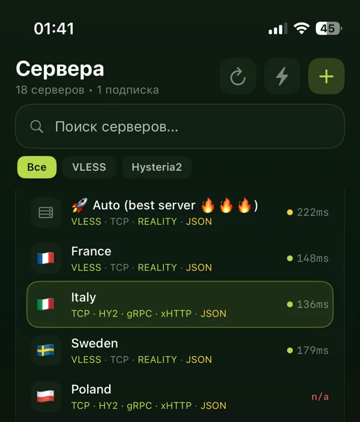
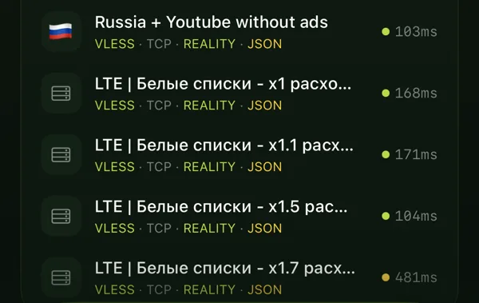
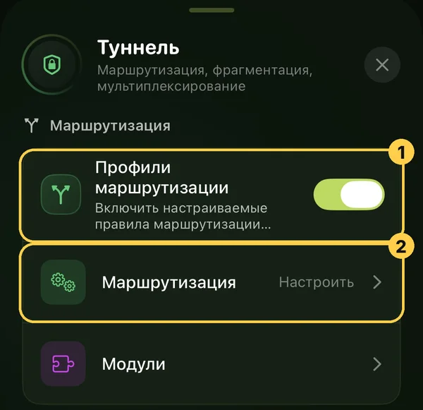
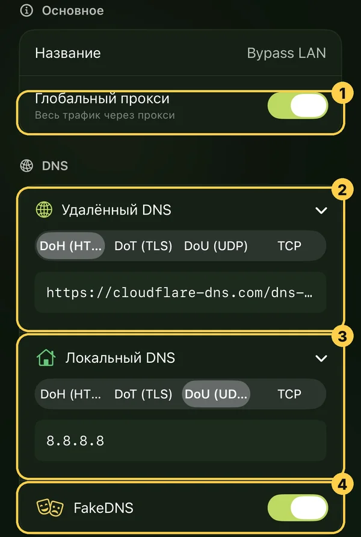
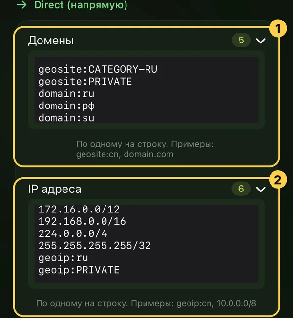
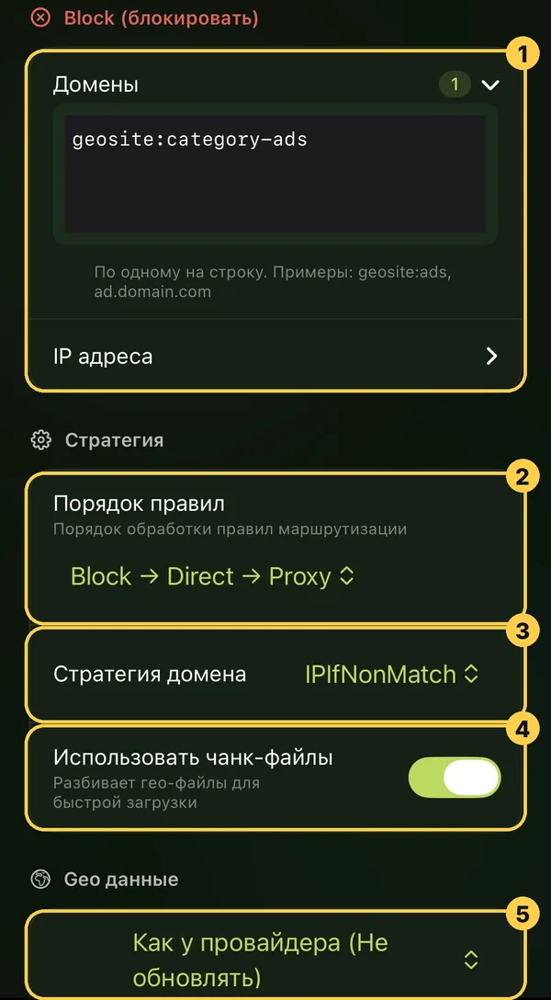
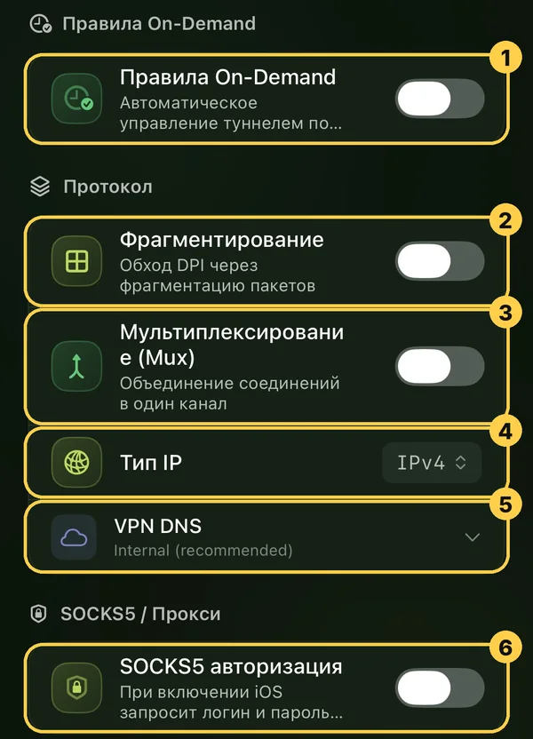
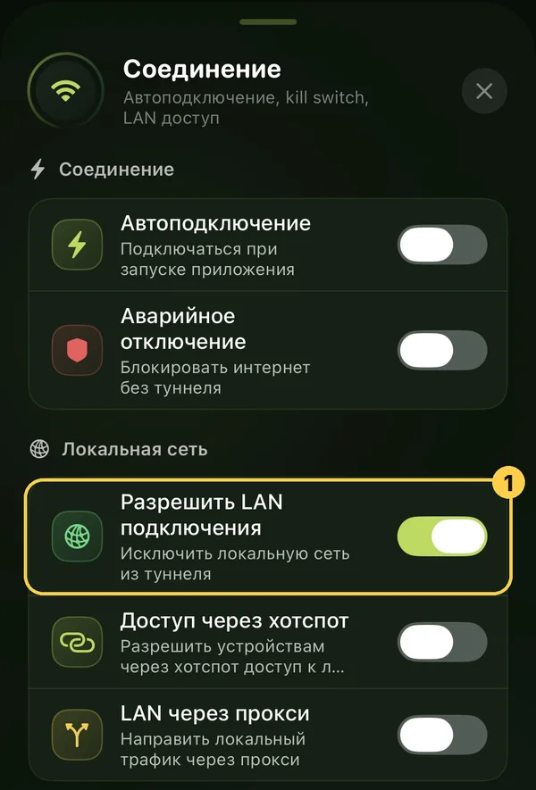
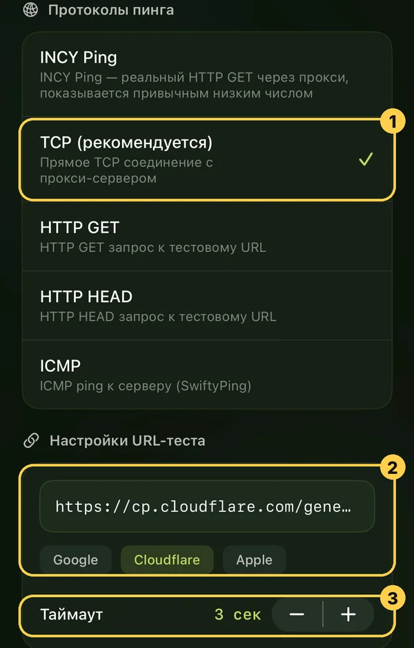

<b>Коротко:</b> если в Incy сайты иногда «зависают», банки не открываются с VPN, а на мобильном интернете скачет пинг, это почти всегда лечится настройками. Выберите сервер VLESS + Reality, выключите фрагментирование и Mux, а российские сайты пустите напрямую через профиль маршрутизации. Ниже 10 шагов на настоящих скриншотах Incy для iPhone: жёлтый номер на картинке = номер пункта в тексте.

Эти настройки мы подобрали и проверили на клиенте: сутки тестов на домашней оптике, 4G-модеме и мобильном интернете.

<b>Нужен такой же разбор для Android, Windows, Mac или телевизора?</b> Напишите нам в [поддержку](https://t.me/ThuggerVPN_supp), и мы обязательно добавим инструкцию для вашего устройства.

## Шаг 1. Подключите подписку

Если Incy ещё пустой, сначала добавьте подписку: скопируйте ссылку у VPN-сервиса, откройте Incy и нажмите «Из буфера». Подробно с самого начала в статье [«Incy VPN: как добавить подписку»](/blog/incy-vpn-kak-nastroit/). Когда во вкладке «Серверы» появился список, переходите к шагу 2.

## Шаг 2. Выберите правильный сервер

<figure><figcaption>Вкладка «Серверы». Под страной написан протокол, справа задержка.</figcaption></figure>

Внизу экрана откройте вкладку «Серверы». Под каждой страной мелко написан протокол:

| Что написано под страной | Когда выбирать |
|---|---|
| **VLESS · TCP · REALITY** | основной выбор: ровный пинг, высокая скорость, лучше всего проходит фильтры мобильных операторов |
| **HY2** (Hysteria2) | запасной вариант, если на Reality тормозит видео при слабом сигнале |
| красная точка или n/a | сервер сейчас недоступен или медленный, выберите другой |

Цифра справа (например, 41ms) - задержка: чем меньше, тем лучше. Зелёная точка «отлично», жёлтая «нормально», красная «плохо». Строка «Auto (best server)» сама выбирает самый быстрый сервер.

<figure><figcaption>Серверы «LTE | Белые списки» - для режима белых списков на мобильном.</figcaption></figure>

Если в подписке есть серверы «LTE | Белые списки», выбирайте их, только когда оператор включил белые списки. В обычное время берите обычный сервер VLESS · Reality: он быстрее. Включены ли сейчас белые списки, покажет [проверка интернета](/check/) за 5 секунд.

## Шаг 3. Включите профили маршрутизации

<figure><figcaption>«Настройки» → «Туннель».</figcaption></figure>

Откройте «Настройки» (шестерёнка внизу справа) → «Туннель».

1. **Профили маршрутизации:** включите.
2. **Маршрутизация → Настроить:** нажмите, чтобы открыть профиль. Если профиля нет, создайте новый, если есть, откройте его для редактирования.

Зачем это: российские сайты, банки и Госуслуги будут работать напрямую, а всё зарубежное через VPN. Не придётся включать и выключать VPN, чтобы зайти в банк.

## Шаг 4. DNS профиля

<figure><figcaption>Верх профиля маршрутизации: основное и DNS.</figcaption></figure>

1. **Глобальный прокси:** вкл. Всё, что не попадёт в правило «напрямую», пойдёт через VPN.
2. **Удалённый DNS:** вкладка **DoH**, адрес Cloudflare (стоит по умолчанию).
3. **Локальный DNS:** вкладка **DoU (UDP)**, адрес `8.8.8.8`.
4. **FakeDNS:** вкл.

## Шаг 5. Российские сайты напрямую

<figure><figcaption>Раздел «Direct (напрямую)»: домены и IP-адреса.</figcaption></figure>

Ниже в профиле раздел «Direct (напрямую)».

1. **Домены.** Нажмите и впишите по одному на строку (можно скопировать отсюда):
<pre class="cb">geosite:category-ru
geosite:private
domain:ru
domain:рф
domain:su</pre>
Проверьте написание: ошибка в одной букве (например, «donain» вместо «domain») молча отключает правило.
2. **IP адреса.** Локальные адреса, которые уже стоят в списке (172.16.0.0/12, 192.168.0.0/16 и другие), не трогайте и добавьте в конец:
<pre class="cb">geoip:ru
geoip:private</pre>

Раздел «Proxy (через прокси)» оставьте пустым.

## Шаг 6. Блокировка рекламы и порядок правил

<figure><figcaption>Низ профиля: блокировка, стратегия и гео-данные.</figcaption></figure>

1. **Block (блокировать) → Домены:** `geosite:category-ads`. Заодно уберёт часть рекламы.
2. **Порядок правил:** Block → Direct → Proxy.
3. **Стратегия домена:** IPIfNonMatch.
4. **Использовать чанк-файлы:** вкл.
5. **Geo данные:** «Как у провайдера (Не обновлять)».

Нажмите **«Сохранить»** вверху справа.

## Шаг 7. Протокол

<figure><figcaption>«Настройки» → «Туннель», ниже: On-Demand и «Протокол».</figcaption></figure>

Вернитесь в «Туннель» и пролистайте ниже:

1. **Правила On-Demand.** Включите, если хотите, чтобы VPN сам поднимался при смене сети (например, вышли из дома на мобильный интернет). Если удобнее включать VPN вручную, оставьте выключенным, как на скриншоте.
2. **Фрагментирование:** выкл. Для серверов Reality не нужно, а на мобильном повышает пинг.
3. **Мультиплексирование (Mux):** выкл. Иначе при потере одного пакета на LTE «замирают» все вкладки разом.
4. **Тип IP:** IPv4. Без лишних задержек на попытки подключиться по IPv6.
5. **VPN DNS:** Internal (recommended).
6. **SOCKS5 авторизация:** выкл.

Если у вас версия Incy с полем **MTU** (на iPhone его нет), поставьте **1360**: это убирает зависание сайтов на LTE и 4G-модемах.

## Шаг 8. Соединение и локальная сеть

<figure><figcaption>«Настройки» → «Соединение».</figcaption></figure>

1. **Разрешить LAN подключения:** вкл. Тогда при включённом VPN будут работать принтер, телевизор, умный дом и второй роутер дома.

Остальное по желанию: «Автоподключение» включает VPN при запуске приложения, «Аварийное отключение» (kill switch) блокирует интернет, если VPN отвалился.

## Шаг 9. Пинг

<figure><figcaption>«Настройки» → «Пинг».</figcaption></figure>

1. **Протокол пинга:** TCP (рекомендуется). Показывает честную задержку до сервера.
2. **URL-тест:** Cloudflare.
3. **Таймаут:** 3 сек.

## Шаг 10. Обновление подписки и Wi-Fi на iPhone

В настройках провайдера (подписки):

- **Автообновление:** вкл, раз в 12 или 24 часа. Если сервис поменяет серверы из-за блокировок, список обновится сам.
- **Уведомлять, Обновлять при открытии, Пинг при запуске, Пинг при обновлении:** нет. Приложение будет запускаться быстрее.
- **Отправлять HWID:** да.

<figure><figcaption>Схема: «Настройки» iPhone → Wi-Fi → (i) у домашней сети.</figcaption></figure>

Если дома два роутера и больше (Mesh), откройте на iPhone «Настройки» → Wi-Fi → значок (i) у домашней сети и выключите **«Частный адрес Wi-Fi»** (или выберите «Фиксированный») и **«Ограничение трекинга IP-адреса»**. Иначе при переходе из комнаты в комнату VPN может обрываться.

## Если после настройки стало хуже

- **Ничего не открывается.** Проверьте, что раздел Proxy пустой, а в доменах нет опечаток.
- **Не открывается конкретный российский сайт.** Добавьте его в Direct → Домены строкой вида `domain:site.com`.
- **Не открывается зарубежный сайт.** Значит, он попал в Direct. Проверьте, что не добавили лишнего.
- **Ничего не помогает.** Выберите другой сервер VLESS · Reality или запустите [проверку интернета](/check/): если у оператора белые списки, настройки тут ни при чём.

<b>Осторожно с экспортом настроек.</b> Файл экспорта из Incy содержит ваши ключи доступа и идентификатор подписки. Переносите его только между своими устройствами (например, через AirDrop) и никому не пересылайте.

<b>Остались вопросы или нужна инструкция для другого устройства?</b> Пишите в [поддержку](https://t.me/ThuggerVPN_supp) или в чат «Помощь» внизу справа на сайте.

## Вопросы и ответы

### Какой протокол лучше в Incy: VLESS Reality или Hysteria2?

Для России основной выбор VLESS + Reality: ровный пинг и лучшая устойчивость к фильтрам операторов. Hysteria2 держите запасным, если на Reality тормозит видео при слабом сигнале.

### Почему с Incy не работают банки и Госуслуги?

Потому что весь трафик идёт через зарубежный сервер, а многие российские сервисы такие подключения не любят. Профиль маршрутизации из шагов 3-6 решает это: российские сайты идут мимо VPN. Подробнее в статье [«Банки не работают с VPN»](/blog/vpn-i-bankovskie-prilozheniya/).

### Нужно ли включать фрагментирование и Mux?

Нет. Для серверов VLESS + Reality фрагментирование не нужно и повышает пинг, а Mux на мобильной сети приводит к зависанию всех вкладок при потере пакета.

### Какой MTU ставить для мобильного интернета?

1360, если в вашей версии Incy есть это поле. Оно убирает зависания сайтов на LTE и 4G-модемах. В версии для iPhone этого поля нет, там его можно пропустить.
